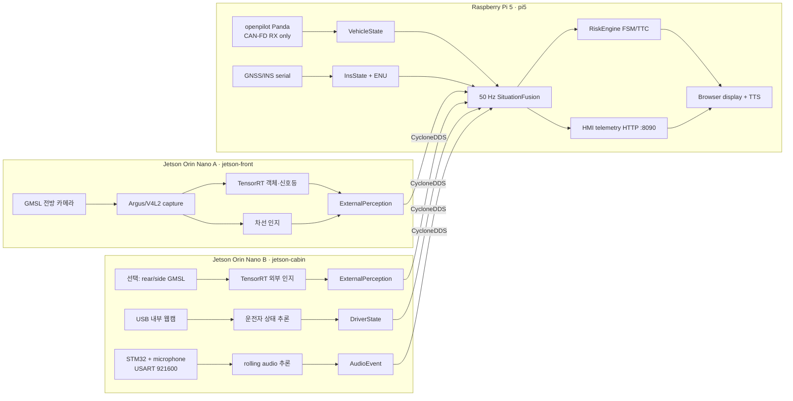

# CODRIVE 시스템 아키텍처

## 1. 설계 결론

이 프레임워크는 **운전자에게 경고와 행동 권고를 제공하는 수신 전용 보조 시스템**이다.
Raspberry Pi 5의 “control”은 센서 수집, 상태 융합, 위험 FSM, HMI 오케스트레이션을 뜻하며
조향·가감속 ECU 제어를 뜻하지 않는다. Panda CAN 송신은 코드 인터페이스에서 제외한다.

두 Jetson은 프레임 단위로 일을 주고받는 동적 로드밸런싱 대신, 물리 입력별로 고정 분할한다.
영상 원본을 DDS로 전달하면 대역폭과 지연이 커지고 카메라가 연결된 Jetson이 단일 장애점인 사실도
바뀌지 않기 때문이다. 각 Jetson은 캡처부터 추적까지 로컬에서 끝내고 정형 인지 결과만 보낸다.

외부 카메라가 한 대뿐이면 A는 외부 인지, B는 내부 카메라와 음향 인지만 맡는다. 후방/측면
GMSL이 추가되면 B에 연결해 외부 인지 파이프라인도 활성화한다. 카메라별 `camera_id`,
`frame_id`, extrinsic calibration은 반드시 고정해야 한다.

## 2. 물리 배치

| 장치 | 직접 연결 | 소유 프로세스 | 출력 |
|---|---|---|---|
| Jetson A | carrier board의 front GMSL | capture, YOLO/TensorRT, lane, tracker | `ExternalPerception(front)` |
| Jetson B | USB cabin webcam, STM32 USART, 선택 rear/side GMSL | DMS, audio classifier, 선택 외부 인지 | `DriverState`, `AudioEvent`, 선택 `ExternalPerception` |
| Pi 5 | Panda USB, GNSS/INS UART/USB, display, speaker | CAN/INS gateway, fusion, risk, guidance, HMI | snapshot, risk, HMI, health |

STM32는 16 kHz, mono, signed PCM16을 20 ms 단위로 보낸다. 실제 페이로드는 256 kbit/s이고
8N1 오버헤드를 포함하면 320 kbit/s이므로 460800 baud가 이론적 하한이다. 프레이밍 복구와
여유를 위해 921600 baud를 기본값으로 둔다.

## 3. DDS 계약

모든 토픽은 공통 `DdsEnvelope`와 내부 JSON 스키마 버전 1을 사용한다. envelope에는
`source_id`, `sequence`, `capture_time_ns`, `publish_time_ns`, `schema_version`, payload가 있다.
도메인 모델의 `Header`에는 여기에 `frame_id`, `boot_id`, `trace_id`, 로컬 `monotonic_ns`를
추가한다. 잘못된 필드와 오래되거나 역순인 sequence는 Pi fusion에서 거부한다.
`source_id`는 DDS instance key이므로 노드명만 쓰지 않고 `jetson-front.front`,
`jetson-cabin.dms`, `jetson-cabin.audio`처럼 stream별로 고유하게 둔다. 프로세스 재시작마다
새 `boot_id`를 만들고 stream별 sequence를 0부터 증가시킨다.

| Registry key | DDS topic | 발행자 | 목표 주기 | QoS profile | 유효시간 |
|---|---|---|---:|---|---:|
| `external_perception` | `codrive/v1/perception/external` | Jetson A/B | 30 Hz/camera | SENSOR_LATEST | 250 ms |
| `driver_state` | `codrive/v1/perception/driver` | Jetson B | 15 Hz | SENSOR_LATEST | 400 ms |
| `audio_event` | `codrive/v1/perception/audio` | Jetson B | 10 Hz/event | EVENT_LATEST | 1 s |
| `environment_state` | `codrive/v1/environment/state` | Pi context service | 1/60 Hz | CONTEXT_STATE | 5 min |
| `vehicle_state` | `codrive/v1/vehicle/state` | Pi Panda gateway | 50–100 Hz | SENSOR_LATEST | 120 ms |
| `ins_state` | `codrive/v1/localization/ins` | Pi INS gateway | 20–100 Hz | SENSOR_LATEST | 250 ms |
| `situation_snapshot` | `codrive/v1/fusion/snapshot` | Pi fusion | 50 Hz | STATE_LATEST | 200 ms |
| `risk_event` | `codrive/v1/risk/event` | Pi risk | event | CRITICAL_EVENT | 1.5 s |
| `hmi_command` | `codrive/v1/hmi/command` | Pi HMI policy | event | HMI_LATEST | 1.5 s |
| `node_health` | `codrive/v1/system/health` | all nodes | 2 Hz | HEALTH | 1.5 s |

고율 센서는 `best-effort + keep-last(1)`로 낡은 샘플의 큐 적체를 막는다. 위험과 HMI는
`reliable + transient-local`이지만 HMI는 source별 마지막 명령 하나만 보관하며 payload의
`expires_at_ns`를 지난 명령을 절대 표시하지 않는다.
카메라 프레임과 PCM 원본은 DDS로 보내지 않는다. HMI 전방 화면은 Jetson A의 별도 MJPEG
HTTP 스트림(기본 960 px, 12 fps, port 8080)을 사용한다. 이 경로는 최신 프레임만 유지하는
비안전 표시 경로이며, 끊기거나 느려져도 DDS 인지 결과와 Risk/HMI 명령에는 영향을 주지 않는다.
Pi의 브라우저 HMI는 같은 프로세스의 읽기 전용 HTTP bridge(port 8090)에서 융합된 최신
`VehicleState`를 20 Hz로 읽는다. 속도·조향·브레이크·가속페달은 fusion의 120 ms TTL과 bridge의
500 ms watchdog을 통과할 때만 연결 상태로 표시한다.

Pi fusion은 stream별 source allowlist도 적용한다. 이는 오설정/우발적 충돌 방지책이지 공격자
인증은 아니다. 대회 데모망은 외부와 분리된 유선 VLAN으로 구성하고, 신뢰할 수 없는 노드가
접속할 수 있는 환경에서는 CycloneDDS Security 인증·접근제어를 별도로 적용해야 한다.

## 4. 시간 기준과 융합

호스트별 monotonic clock 값은 서로 비교할 수 없다. Pi 5를 PTP grandmaster로 두고 두 Jetson을
slave로 동기화하며, 하드웨어 타임스탬프가 불가능하면 chrony를 대체 수단으로 사용한다.

- `capture_time_ns`: PTP로 동기화된 Unix 시각. 장치 간 융합에 사용.
- `publish_time_ns`: 추론 결과가 생성된 시각. 전송 전 처리 지연 계산에 사용.
- `monotonic_ns`: 같은 프로세스 안의 deadline/latency 측정에만 사용.
- 허용 clock offset: 5 ms 목표, 미래 timestamp 50 ms 초과 시 샘플 폐기.
- Fusion은 카메라별 최신 유효 결과를 보관하고 TTL을 넘은 결과는 snapshot에서 제거한다.

## 5. 200 ms 안전 경로

| 구간 | 예산 |
|---|---:|
| 노출·캡처 | 33 ms |
| 전처리 + TensorRT 추론 | 80 ms |
| 추적·후처리 | 15 ms |
| DDS 전송 | 10 ms |
| Pi fusion + RiskEngine | 15 ms |
| HMI/TTS dispatch | 20 ms |
| 여유 | 27 ms |
| **합계** | **200 ms** |

이 표는 설계 예산이지 현재 측정 결과가 아니다. `codrive-sim`은 이미 만들어진 typed sample 이후의
Pi 계산만 측정한다. 실측 합격 판정은 카메라 exposure timestamp부터 HMI frame swap과 TTS enqueue까지
동일 `trace_id`로 기록한 p50/p95/p99 결과로 해야 한다.

CRITICAL 경로는 완전히 로컬이며 템플릿만 사용한다. LLM은 WARNING/INFO 설명을 나중에
자연스럽게 바꾸는 선택 기능일 뿐이고, timeout 또는 인터넷 단절 시 최초 템플릿을 유지한다.
자료의 “3초 오디오 버퍼”는 3초를 기다리는 방식이 아니라 rolling buffer로 해석한다. 기본은
960 ms window, 100 ms hop이며 모델 요구에 따라 history만 3초까지 유지한다.

## 6. RiskEngine 우선순위

한 시점에는 점수가 가장 높은 단일 행동 지침만 HMI로 보낸다.

1. 비의도 급가속(CAN accelerator + INS acceleration 교차 확인)
2. 보행자 충돌 TTC
3. 적색 신호 접근 중 브레이크 미작동
4. 차선 이탈
5. 운전자 졸음 및 마이크로수면
6. 운전자 주의 분산과 외부 위험의 결합
7. 사이렌/경적 및 일반 정보

현재 코드는 설명 가능한 규칙과 evidence를 남기며 같은 이벤트는 cooldown 동안 억제한다.
WARNING이 CRITICAL로 상승하면 cooldown 중에도 즉시 재발행한다. 임계값은 실차 기록으로
튜닝해야 하며 모델 confidence만으로 자동 제동 같은 차량 제어를 수행해서는 안 된다.

## 7. Fail-safe와 기능 강등

| 감지 | 판정 | 대응 |
|---|---|---|
| front perception 없음 | 250 ms 초과 | 영상 기반 TTC/신호/차선 기능 중지, HMI에 센서 장애 표시 |
| CAN 상태 없음 | 120 ms 초과 | 속도 의존 위험 판단 중지, `VehicleState.can_valid=false` |
| INS 없음/RTK 저하 | 250 ms 초과/fix 변화 | 위치 기반 기능 강등, CAN·vision만 유지 |
| cabin/DMS 없음 | 400 ms 초과 | 운전자 졸음·주의 분산 규칙 중지 |
| Jetson heartbeat 없음 | 3회 | 해당 worker 결과 폐기, supervisor 경고 |
| LLM/API 지연 | deadline 초과 | 템플릿 유지; CRITICAL 경로 영향 없음 |
| 프로세스 종료 | systemd watchdog | 제한된 restart burst 후 장치 DEGRADED |
| Pi 과부하 | fusion deadline miss | raw logging/preview/LLM부터 차례로 끄고 risk/HMI 우선 |

마지막 인지 결과를 무기한 유지하는 것은 fail-safe가 아니다. 각 데이터 TTL이 지나면 명시적으로
`stale_sources`에 넣고 그 입력을 요구하는 규칙을 중지한다.

## 8. 아직 실차 전에 확정할 항목

- 정확한 GMSL 센서/serializer/deserializer/carrier 모델과 JetPack 버전
- 카메라 수, 위치, sensor-id, intrinsic/extrinsic calibration
- 2022 EV6의 정확한 fingerprint, Panda 연결 bus, 검증된 DBC와 signal 이름
- INS 제조사/모델, serial baud, 출력률과 ENU 원점. NovAtel/NMEA checksum 검증은 활성화
- STM32 firmware의 실제 PCM sampling clock과 USART 포트
- 마이크가 단일 채널이면 사이렌/경적 종류만 알 수 있고 접근 방향은 알 수 없음. 방향이 필요하면
  동기화된 다채널 마이크 배열이나 rear/side camera와의 결합이 필요
- HMI 디스플레이 해상도, TTS 엔진, 앰프/스피커 출력
- 실제 차량 제어가 필요한지 여부. 필요하다면 이 advisory 프레임워크와 분리된 안전 설계가 필요
